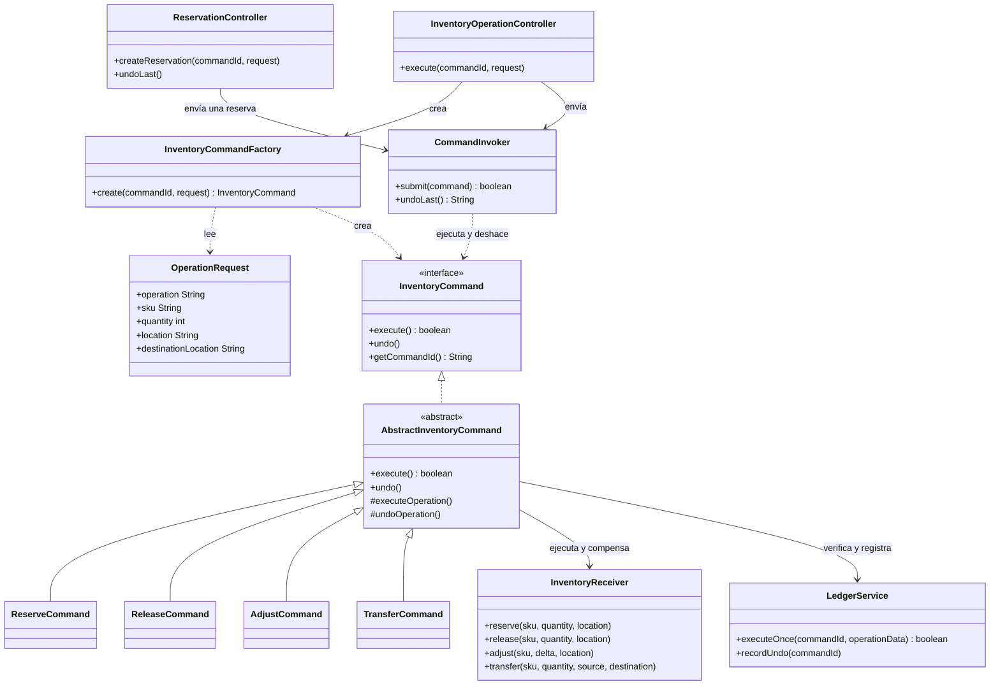
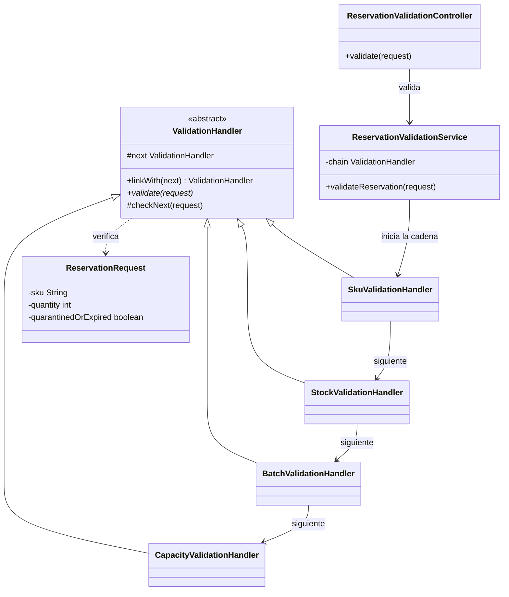
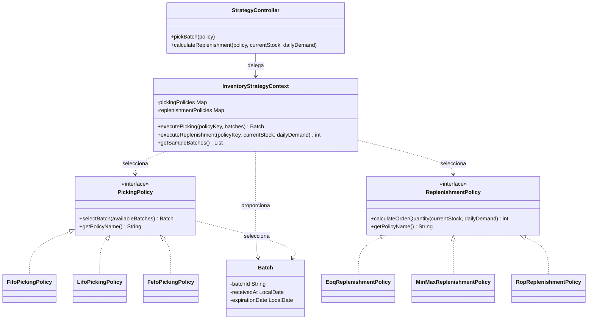
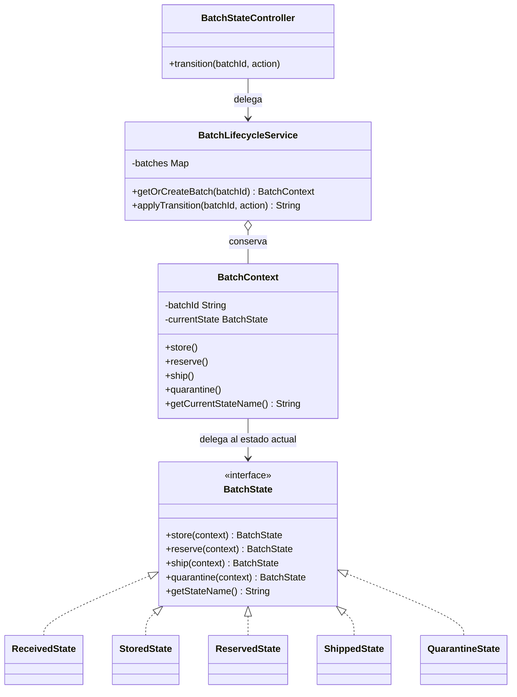
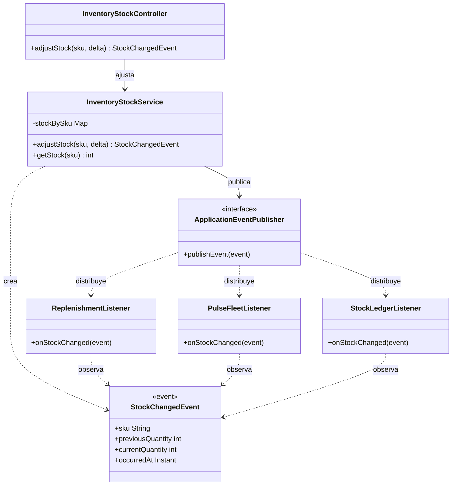
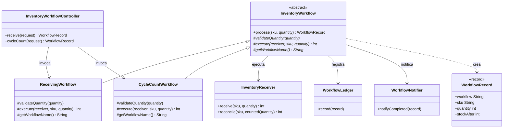

# Patrones de LOGISTPULSE Smart Inventory

Este espacio de trabajo contiene ejemplos pequeños e independientes, implementados con Spring Boot, de los seis patrones de comportamiento de la presentación. Cada proyecto es un prototipo didáctico en memoria, no un servicio de inventario listo para producción.

| Patrón | Proyecto | Ejemplo |
| --- | --- | --- |
| Comando | [logistpulse-command-pattern](./logistpulse-command-pattern) | Comandos para reservar, liberar, ajustar y transferir; idempotencia basada en los datos; deshacer en orden LIFO y un ledger estructurado. |
| Cadena de responsabilidad | [logistpulse-chain-pattern](./logistpulse-chain-pattern) | Las validaciones de una reserva se ejecutan en orden: SKU, stock, lote y capacidad. |
| Estrategia | [logistpulse-strategy-pattern](./logistpulse-strategy-pattern) | Picking FEFO/FIFO/LIFO y reposición EOQ/MIN_MAX/ROP. |
| Estado | [logistpulse-state-pattern](./logistpulse-state-pattern) | Un lote delega las transiciones de su ciclo de vida al estado actual. |
| Observador | [logistpulse-observer-pattern](./logistpulse-observer-pattern) | Los cambios de stock se publican a los listeners de reposición, PULSEFLEET y auditoría. |
| Método plantilla | [logistpulse-template-method-pattern](./logistpulse-template-method-pattern) | Recepción y conteo cíclico comparten el flujo validar/ejecutar/registrar/notificar. |

## Comando

Cada operación es un objeto comando. El invocador conserva los comandos ejecutados para deshacerlos en orden LIFO, y el ledger compara todos los datos de la operación asociados a una clave de idempotencia.



## Cadena de responsabilidad

El servicio de validación enlaza los manejadores en orden. Cada manejador rechaza una entrada inválida o la pasa al siguiente eslabón.



## Estrategia

El contexto elige una política de picking o reposición mediante una clave y delega el algoritmo a dicha política.



## Estado

`BatchContext` delega cada acción del ciclo de vida al estado actual. Si la transición tiene éxito, el método del estado devuelve el siguiente estado; si la rechaza, lanza una excepción y el estado actual se conserva.



## Observador

El servicio de inventario publica un `StockChangedEvent`; suscriptores independientes gestionan alertas de reposición, notificaciones para PULSEFLEET y registros de auditoría.



## Método plantilla

`InventoryWorkflow.process()` fija la secuencia —validar, ejecutar, registrar y notificar— mientras que la recepción y el conteo cíclico definen su propia validación y operación de inventario.



## Ejecutar un ejemplo

Ejecuta Maven desde el directorio de cada proyecto:

```text
mvn spring-boot:run
```

Ejecuta sus pruebas con:

```text
mvn test
```

Los ejemplos usan estado en memoria y no ofrecen persistencia, transacciones ni garantías de concurrencia para uso en producción.
