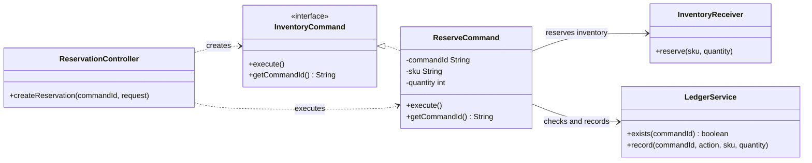
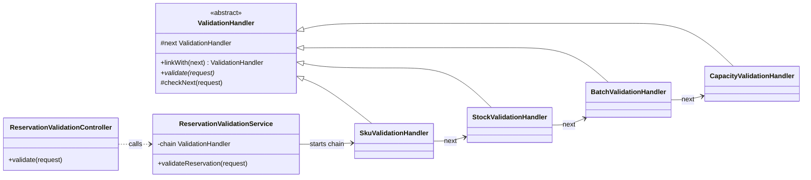
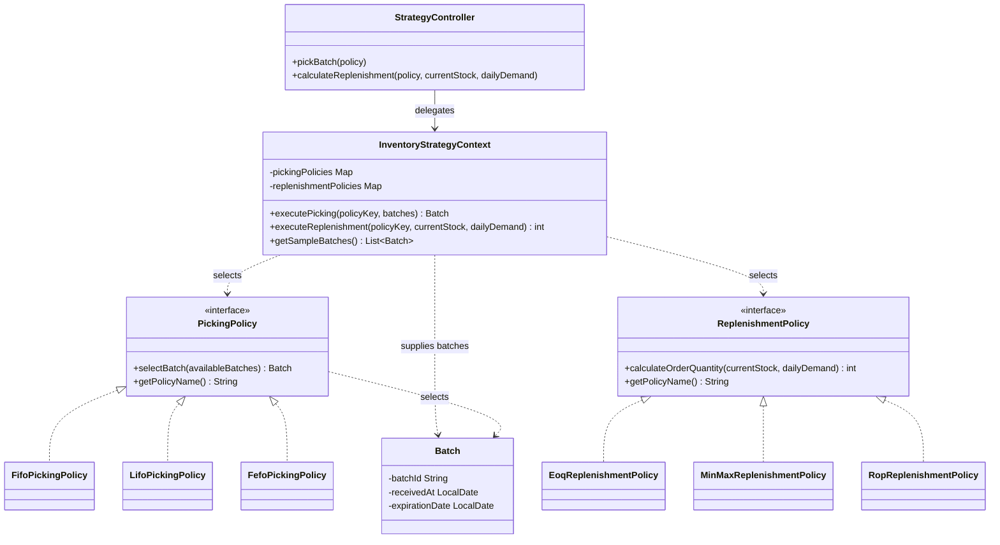

# LogistPulse Inventory Design Patterns

This repository contains three small Spring Boot examples of inventory workflows implemented with design patterns:

- **Command** — the root Maven project, which models inventory reservations as executable commands.
- **Chain of Responsibility** — `logistpulse-chain-pattern`, which validates a reservation through an ordered sequence of handlers.
- **Strategy** — `logistpulse-strategy-pattern`, which selects interchangeable batch-picking and replenishment policies.

## Command Pattern

`ReservationController` creates a `ReserveCommand` from the incoming reservation request and command ID. The command delegates the reservation to `InventoryReceiver` and records successful execution through `LedgerService`. The ledger check makes repeated command IDs idempotent.

## Chain of Responsibility Pattern

The validation service builds this chain in order: SKU, stock, batch status, then capacity. Each handler rejects invalid requests or passes valid requests to the next handler.

## Strategy Pattern

`InventoryStrategyContext` selects a policy by key and delegates the work. Picking and replenishment are separate strategy families, each with its own interface and implementations. Unknown keys use FIFO for picking and MIN_MAX for replenishment.

