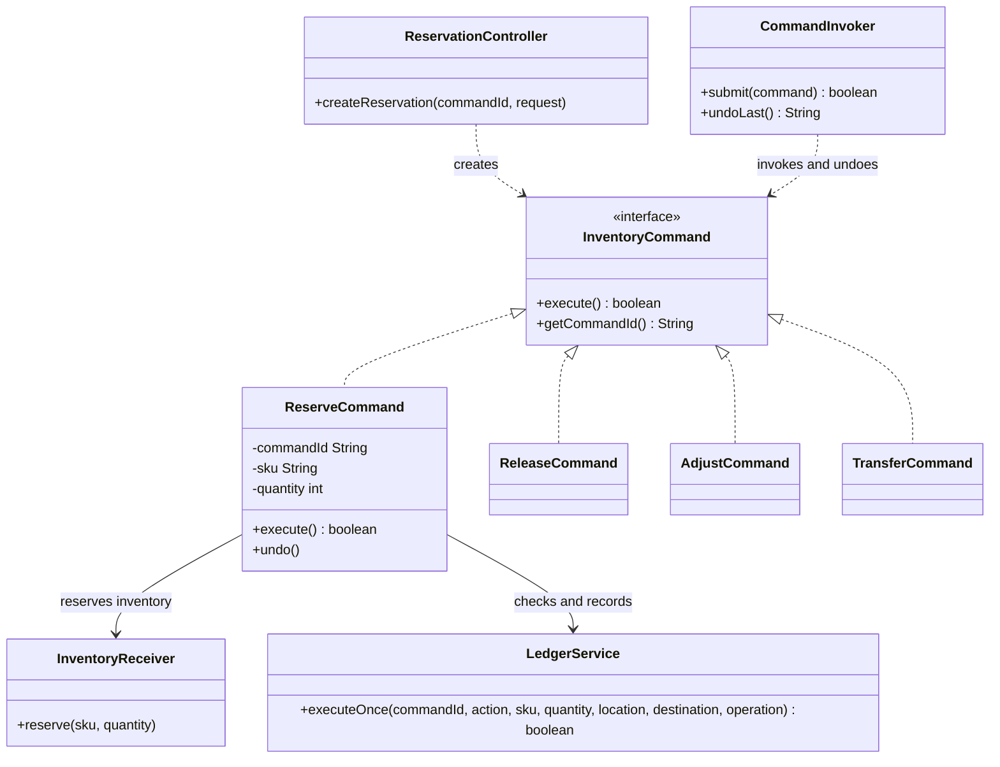

# Command Pattern

This Spring Boot example models reserve, release, adjust, and transfer operations as command objects. `CommandInvoker` submits commands and undoes them in LIFO order; `InventoryReceiver` owns stock per SKU and location, and `LedgerService` records successful operations and undo events.

The ledger compares the complete operation payload for a reused ID: an identical retry is reported as a duplicate, while reusing the ID with different data returns a conflict. Failed operations do not consume their command IDs. Undo is retained in history if its compensating operation fails.

The state and ledger are in memory, so this is a pattern demonstration rather than production persistence or transaction management.

## Endpoints

- `POST /operations` with `X-Command-Id` and JSON fields `operation`, `sku`, `quantity`, and `location`; `destinationLocation` is required for transfers.
- `POST /reservations` remains a convenience endpoint for a reservation at location `MAIN`.
- `POST /reservations/undo` compensates the latest successful command.

Example operation body:

```json
{
  "operation": "ADJUST",
  "sku": "SKU-1",
  "quantity": 100,
  "location": "MAIN"
}
```

## Class diagram


